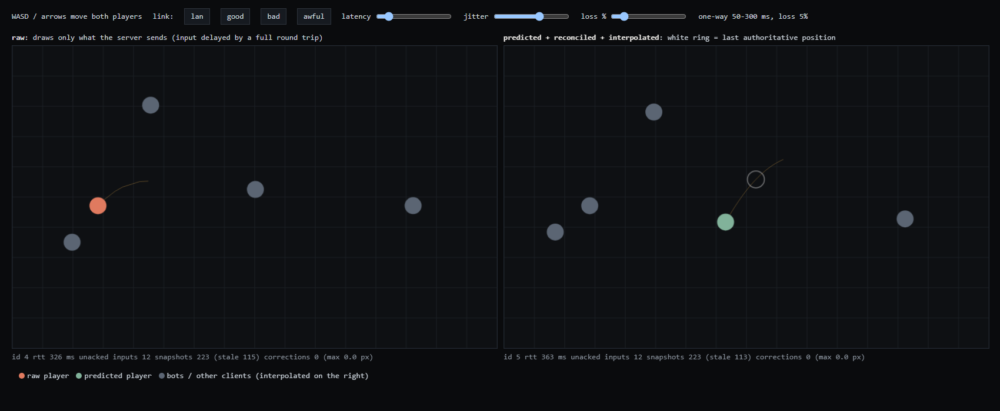

# tick-net

tick-net is an authoritative game server and client harness in TypeScript with **zero dependencies**. It implements:

- client-side prediction
- server reconciliation
- an input reorder buffer on the server
- entity interpolation for other players
- a deterministic link simulator for latency, jitter (50–300 ms one-way), loss and duplication

A browser test client runs two connections side by side: *raw* (draw what the server says) and *predicted + reconciled + interpolated*.



*On the "bad" link (one-way 50–300 ms, 5% loss): the green predicted player runs ahead of its last authoritative position (white ring), while the raw player on the left still shows where the server had it about one round trip ago.*

```bash
npm start            # build browser files, serve on http://127.0.0.1:8090 (add ?autopilot to steer hands-free)
npm test             # 12 tests (node:test)
npm run bench        # netcode comparison + server tick cost
```

You need Node 23.6 or later; Node runs the `.ts` files directly. The WebSocket server is a hand-written RFC 6455 implementation (`src/ws.ts`, about 130 lines). The browser build strips types with Node's built-in `module.stripTypeScriptTypes`. There is no `node_modules`.

## How it works

```
client (60 fps render, 30 Hz input)                          server (30 Hz, authoritative)
  input #n ──► predict: me = apply(me, #n)                     queue inputs by seq; drop dupes; cap 32
          └──► send {inputs: last 4 unacked} ──[ link sim ]──► each tick: apply ≤3 in seq order
                                                               (wait ≤3 ticks for a missing seq)
  snapshot{tick, you, ack, players} ◄──────────[ link sim ]─── snapshot to every client
          ├──► drop if tick ≤ last seen (reordered)
          ├──► reconcile: me = server_me; replay inputs with seq > ack
          └──► buffer for remotes; draw them at now − 100 ms, lerp between bracketing snapshots
```

**Determinism.** Server and client run the same `applyInput()`: inputs are clamped, diagonals normalized, and positions rounded to 1/1000 px. With identical inputs the two sides compute identical positions, so reconciliation replays to exactly the predicted state and nothing is visibly corrected. The harness tests show the predicted client's final position matches the server's to 0.000 px on every preset.

**Input redundancy.** Every input packet repeats the last 4 unacknowledged inputs, and the server discards sequence numbers it has already seen. Losing one packet costs nothing, because the next packet carries the same input again.

**Reorder buffer.** This came out of a measurement:
- **The problem.** With 250 ms of jitter, a newer packet can overtake an older one. That older one might hold the only remaining copy of input #16, once that input is more than 4 inputs behind the newest. The server applied #17–20, then dropped the late #16 as stale, and the client had to correct.
- **The fix.** When the next sequence number is missing but later inputs are queued, the server now waits up to 3 ticks (100 ms) before skipping the gap.

Corrections per 12 s run, averaged over 8 seeds:

| link | no buffer | 3-tick buffer | 6-tick buffer |
|---|---:|---:|---:|
| bad (50–300 ms, 5% loss) | 4.4 (max 22 px) | **0.0** | 0.0 |
| awful (150–450 ms, 15% loss) | 7.6 (max 37 px) | 0.3 (max 15 px) | 0.1 (max 7 px) |

The cost is up to 100 ms of extra delay in what *other* players see of you when a packet is late. Your own view is unaffected, because you predict.

**Interpolation.** Remote players are drawn 100 ms in the past, interpolated between the two snapshots around that moment. If the buffer runs dry, they hold their last position; there is no extrapolation, so they never overshoot through a wall. Raw mode draws the latest snapshot, which judders at 30 Hz and stalls whenever packets arrive late or out of order.

**Robustness fixes found while testing in the browser.**
- **Lost `hello`.** The `hello` message can be lost on a lossy link, which left one demo client with no id and nothing drawn. Now every snapshot carries `you`, the recipient's id.
- **Background tabs.** `requestAnimationFrame` stops firing in background tabs and in headless browsers, and the client stopped sending inputs. Networking now runs on a timer, separate from drawing.

## Link simulator

`Link<T>` delays each message by `latency + U[0, jitter)` ms. It drops a message with probability `loss`, can duplicate messages, and delivers in arrival order, so jitter reorders messages naturally. It is seeded (mulberry32) and runs on any clock, so the harness simulates 12 s of play in a few milliseconds.

| preset | one-way delay | loss | round trip |
|---|---|---:|---|
| `lan` | 2–3 ms | 0% | about 5 ms |
| `good` | 25–50 ms | 0% | 50–100 ms |
| `bad` | 50–300 ms | 5% | 100–600 ms |
| `awful` | 150–450 ms, 2% duplicated | 15% | 300–900 ms |

WebSocket runs over TCP, so in the live demo the loss and jitter are injected *at the application layer*, on both clients' send and receive paths. That reproduces what a UDP game transport would see. It does not reproduce TCP's own head-of-line blocking.

## Results

From `npm run bench`: a 12 s scripted path with starts and stops, averaged over 5 seeds, 60 fps render.

| link | mode | input → screen | mean drift from ideal path | corrections | remote jitter* |
|---|---|---:|---:|---:|---:|
| lan | raw | 50 ms | 8.5 px | — | 5.87 px |
| lan | predicted | **0 ms** | 0.0 px | 0 | 0.08 px |
| good | raw | 90 ms | 16.7 px | — | 4.57 px |
| good | predicted | **0 ms** | 0.0 px | 0 | 0.92 px |
| bad | raw | 297 ms | 48.9 px | — | 5.47 px |
| bad | predicted | **0 ms** | 0.0 px | 0 | 1.59 px |
| awful | raw | 620 ms | 84.4 px | — | 5.45 px |
| awful | predicted | **0 ms** | 2.6 px | 0.2 (max 14.7 px) | 1.84 px |

\* Remote jitter is the mean frame-to-frame change in a remote bot's on-screen velocity; lower means smoother.

On `lan`, raw mode still shows 50 ms of latency: up to one 33 ms tick before the input is sent, then the server's next tick, then delivery.

**Server cost.** Every client sends one input per tick, and the measurement includes snapshot fan-out and JSON encoding.

| clients | ms per tick | share of a 30 Hz tick | downstream per client per tick |
|---:|---:|---:|---:|
| 10 | 0.043 | 0.1% | 0.34 KiB |
| 50 | 0.717 | 2.2% | 1.54 KiB |
| 200 | 8.418 | 25.3% | 6.11 KiB |

Snapshots carry every player to every client, so cost and bandwidth grow as O(n²). See the limitations.

## Tests

12 tests:
- deterministic sim and garbage inputs
- protocol validation against malformed and oversized messages
- link latency bounds, loss rate, reordering and determinism
- server ordering, de-duplication, queue cap and the reorder buffer
- reconciliation with and without lost inputs
- stale snapshots, and recovering the client id without `hello`
- interpolation maths
- the harness's claims on all four presets (zero latency for the predicted client, zero final error, smoother remote players)
- the reorder buffer removing corrections
- the RFC 6455 handshake test vector, and framing at every length encoding (≤125, 126, 65,535, 65,536+) including partial frames
- a real end-to-end WebSocket session using Node's built-in client

The browser client was checked in headless Edge through the DevTools protocol (`tools/screenshot.mjs`). After 8 s on the "bad" preset, both clients were connected with a round-trip time of about 330–360 ms and 0 corrections.

## Limitations

- **Full-state snapshots in JSON.** There is no delta compression, interest management or binary encoding. That is fine for dozens of players, but 200 clients already use 25% of the tick budget and 6 KiB per client per tick.
- **Movement only.** There is no lag compensation (server-side rewind for hit detection) and no physics interaction between players. Reconciliation would need them to stay deterministic.
- **WebSocket over TCP.** Real loss stalls the whole stream (head-of-line blocking). WebTransport or WebRTC data channels would allow unreliable delivery.
- **Single-threaded.** One process, no rooms, no authentication.
- **Fixed rates.** Client and server both run at 30 Hz, and the interpolation delay is a fixed 100 ms rather than adapting to measured jitter.

## Layout

```
src/   sim.ts (shared rules) · protocol.ts · linksim.ts · server.ts · client.ts · ws.ts (RFC 6455) · harness.ts
bin/   server.ts (HTTP + WebSocket + static, 30 Hz drift-free tick)
web/   index.html · app.ts (side-by-side client)
bench/ bench.ts      tools/ screenshot.mjs (headless Chromium via DevTools protocol)      test/ netcode.test.ts
```

## License

MIT
